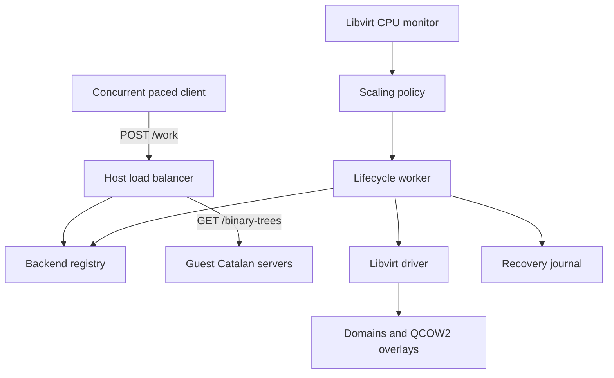

# Cloud AutoScalar

A C++20 cloud-management prototype built with libvirt and QEMU/KVM for
**Programming Assignment 1: Build your own cloud management system**.

The required demonstration starts with one server VM, detects sustained CPU
load, creates a second server, and distributes the same offered load across both.
This implementation also supports draining and removing a replica under low load:

```text
Low traffic: 1 VM → High traffic: 2 VMs → Low traffic: 1 VM
```

Each server VM uses **1 vCPU and 1024 MiB RAM**. Runtime CPU monitoring, disk
provisioning, and VM lifecycle operations invoke libvirt APIs directly.

Already have a provisioned VM and backing image? Start with
[Build and test](#build-and-test), then [Manual testing](#manual-testing).
For a new host, follow [Host setup](#host-setup) and
[Guest and backing-image setup](#guest-and-backing-image-setup) first.

## Architecture



| Component | Responsibility |
|---|---|
| [Orchestrator](orchestrator/Orchestrator.cpp) | Loads configuration, checks prerequisites, and starts the controller and listener |
| [VMMonitor](autoscaler/VMMonitor.cpp) | Calculates CPU usage from successive libvirt CPU-time readings |
| [Policy](autoscaler/Policy.hpp) | Applies thresholds, consecutive-sample requirements, warmup, and cooldown |
| [Autoscaler](autoscaler/Autoscaler.cpp) | Coordinates provisioning, readiness, draining, and recovery |
| [Driver](autoscaler/Driver.cpp) | Implements libvirt domain/storage operations, address discovery, and guest health checks |
| [VMManager](autoscaler/VMManager.hpp) | Stores backend names, IPs, lifecycle states, ownership flags, and in-flight request counts |
| [Load balancer](server/LoadBalancer.cpp) | Routes requests round-robin to ready backends and reports membership |
| [Client](client/LoadGenerator.cpp) | Generates continuous low/high traffic at configured aggregate request rates |
| [Guest server](computation/Catalan.cpp) | Performs deliberately expensive recursive Catalan-number computation |

Backend records live in memory; the recovery journal stores lifecycle ownership
and cleanup state on disk. `Driver` coordinates both domain and storage operations.

CPU sampling continues while a separate, serialized lifecycle worker boots or
removes VMs. The registry selects and reserves a backend atomically. During
scale-in, the selected replica stops receiving new work and is removed only after
its in-flight requests finish.

## Host setup

Use an x86-64 Linux host with KVM available, enough RAM for two guests plus host
overhead, and access to the system libvirt connection. A nested VM must expose
hardware virtualization and `/dev/kvm`.

### Install dependencies

On Debian/Ubuntu:

```bash
sudo apt-get update
sudo apt-get install -y \
  build-essential cmake pkg-config libvirt-dev \
  libvirt-daemon-system libvirt-clients qemu-system-x86 qemu-utils \
  python3 python3-matplotlib python3-pandas curl
```

For graphical VM creation, optionally install `virt-manager` and `virtinst`.
Enable the system libvirt service on hosts using `libvirtd`:

```bash
sudo systemctl enable --now libvirtd
sudo usermod -aG libvirt,kvm "$USER"
```

Log out and back in after changing groups. Hosts using polkit may grant access
through a different policy; verify the connection as the user who will run the
controller:

```bash
ls -l /dev/kvm
virsh -c qemu:///system list --all
pkg-config --modversion libvirt
```

### Check networking and storage

The generated replica XML uses a libvirt NAT network named `default`:

```bash
virsh -c qemu:///system net-list --all
```

If the network is missing, define it from the packaged definition:

```bash
virsh -c qemu:///system net-define /usr/share/libvirt/networks/default.xml
```

If it is inactive, start it. Enable autostart once:

```bash
virsh -c qemu:///system net-start default
virsh -c qemu:///system net-autostart default
```

The sample configuration uses the directory storage pool `default`, targeting
`/var/lib/libvirt/images`. Check it before defining anything:

```bash
virsh -c qemu:///system pool-list --all
virsh -c qemu:///system pool-info default
virsh -c qemu:///system pool-dumpxml default
```

If the pool is missing, create and enable it:

```bash
sudo install -d /var/lib/libvirt/images
virsh -c qemu:///system pool-define-as default dir --target /var/lib/libvirt/images
virsh -c qemu:///system pool-start default
virsh -c qemu:///system pool-autostart default
```

For an existing inactive pool, use only `pool-start`. Network/pool commands that
start or define existing active resources may report an error; inspect the current
state rather than recreating them.

## Build and test

Run commands from the repository root containing `CMakeLists.txt`:

```bash
cmake -S . -B build -DCMAKE_BUILD_TYPE=Release
cmake --build build --parallel 2
ctest --test-dir build --output-on-failure
```

| Executable | Runs on | Purpose |
|---|---|---|
| `build/cloud_autoscalar` | Host | Controller, CPU monitor, and load balancer |
| `build/cloud_autoscalar_client` | Host | Interactive traffic generator |
| `build/catalan-server` | Guest | HTTP computation service; build inside the guest for deployment |

The three CTest suites cover configuration/arithmetic/policy/lifecycle logic,
guest HTTP validation, and concurrent proxy/client behavior. They use simulated
lifecycle operations and mock HTTP backends. **Passing CTest does not replace the
real two-VM demo.** The HTTP tests bind loopback sockets and require host port
8080 to be free, so stop the controller before running them.

## Guest and backing-image setup

### Create the initial VM

Create a guest named **`ubuntu_base`** with:

- 1 vCPU and 1024 MiB RAM.
- A lightweight Ubuntu Server installation and a QCOW2 disk.
- BIOS/Q35 boot, virtio disk/NIC, and the `default` NAT network.
- DHCP networking and OpenSSH for provisioning.

These boot/device settings match the generated replica definitions. The initial
VM must exist and be running before the controller starts; it is never a scale-in
target.

If OpenSSH was skipped during installation, run inside the guest:

```bash
sudo apt-get update
sudo apt-get install -y openssh-server g++ curl
sudo systemctl enable --now ssh
hostname -I
```

On the host, inspect the lease candidates:

```bash
virsh -c qemu:///system domifaddr ubuntu_base --source lease
```

Replace `VM_USER` and `GUEST_IP` in the commands below with your guest username and
working IP. Do not assume a previously assigned address is still current. Libvirt
can report stale leases; after provisioning, use `/health` to confirm an address.

### Install the computation service

From the **host**, copy the required files into one staging directory:

```bash
ssh VM_USER@GUEST_IP 'mkdir -p ~/autoscaler-setup'
scp computation/Catalan.cpp computation/Catalan.hpp \
  computation/catalan-server.service commons/httplib.h \
  tools/provision_guest.sh VM_USER@GUEST_IP:autoscaler-setup/
ssh VM_USER@GUEST_IP
```

Inside the **guest**:

```bash
cd ~/autoscaler-setup
sh provision_guest.sh .
systemctl status catalan-server --no-pager
curl --fail http://127.0.0.1:8080/health
curl --fail 'http://127.0.0.1:8080/binary-trees?n=10'
```

Expect a health response identifying `"workload":"catalan"` and a computation
result of `16796`. The script builds the server, installs it under
`/opt/cloud-autoscalar`, and enables systemd startup under the `cloud-worker`
account. It disables the earlier `cloud-worker.service` if present to avoid a
port conflict. If the guest firewall is active, permit TCP 8080 from the host's
actual libvirt subnet.

Verify the same endpoints from the **host**:

```bash
curl --fail http://GUEST_IP:8080/health
curl --fail 'http://GUEST_IP:8080/binary-trees?n=10'
```

### Make DHCP work in clones

The copied image must obtain a distinct lease with a new MAC address and must not
depend on the original NIC's device name. For a guest with one Ethernet NIC,
configure its existing netplan file along these lines:

```yaml
network:
  version: 2
  ethernets:
    assignment:
      match:
        name: "en*"
      dhcp4: true
      dhcp-identifier: mac
```

If cloud-init owns that file, disable its network regeneration by placing this in
`/etc/cloud/cloud.cfg.d/99-disable-network-config.cfg`:

```yaml
network: {config: disabled}
```

Keep netplan files readable only by root and validate with `sudo netplan generate`.
Apply these settings at the next boot during image preparation. After cloning,
verify that the original and replica have distinct reachable addresses.

### Capture the backing image once

The sample configuration separates the live initial disk from the immutable base:

| Disk | Role |
|---|---|
| `/var/lib/libvirt/images/ubuntu_base.qcow2` | Initial VM's writable disk |
| `/var/lib/libvirt/images/autoscaler-base.qcow2` | Offline backing-image copy |
| Controller-created replica volumes | Separate writable overlays backed by that copy |

From the **host**, after provisioning the guest:

```bash
python3 tools/prepare_image.py autoscaler.config
virsh -c qemu:///system vol-info autoscaler-base.qcow2 --pool default
virsh -c qemu:///system list --all
```

The script requests a clean guest shutdown, waits, copies the managed volume
through libvirt, and restarts the original VM. It refuses to overwrite an existing
base and never forces poweroff. **Skip capture when a suitable base already
exists.** Do not use a running VM's writable disk as the backing image.

Once overlays depend on the base, keep it unchanged. To deploy a new worker
version, provision the guest and prepare a new backing image after accounting for
all existing dependent overlays; changing the live guest does not update old clones.

## Manual testing

Use three host terminals from the repository root. Start with one running initial
VM and the prepared base. The sample configuration supports this walkthrough.

### 1. Start the controller — terminal 1

```bash
./build/cloud_autoscalar autoscaler.config
```

Wait for:

```text
Ready: ubuntu_base; listening on 8080
```

In another terminal, check registration and one request:

```bash
curl -s http://127.0.0.1:8080/replicas | python3 -m json.tool
curl -s http://127.0.0.1:8080/work \
  -H 'Content-Type: application/json' -d '{"value":10}'
```

Expect one ready replica and a success response containing backend `ubuntu_base`
and result `"16796"`.

### 2. Start low traffic — terminal 2

```bash
./build/cloud_autoscalar_client autoscaler.config
```

At the client prompt, enter:

```text
decrease
```

Leave it running for **60 seconds** to cover the 30-second warmup. The initial VM
should remain underloaded and no replica should be created.

### 3. Watch CPU and lifecycle events — terminal 3

```bash
tail -f results/vm_metrics.csv
```

Columns are `timestamp_ms,vm_name,cpu_percent,replica_count`. Press Ctrl+C to stop
following the file when switching to another inspection command:

```bash
tail -f runs/current/events.csv
```

You can also watch virt-manager's CPU graphs or inspect domains with
`virsh -c qemu:///system list --all`. Controller stdout primarily reports startup
and errors; CSV files provide the CPU and lifecycle detail.

### 4. Increase traffic and verify scale-out

Enter `increase` in the client terminal. Expected sequence:

1. Initial-VM CPU exceeds 75% for three consecutive valid samples.
2. The controller creates an `autoscaler-*` replica and waits for its HTTP health.
3. `/replicas` lists two ready backends and the client reports the membership change.
4. Both VMs receive requests; each CPU usage should fall relative to the overloaded
   initial VM while the aggregate request rate remains unchanged.

Keep high traffic running for **at least 60 seconds after the second VM is ready**.
Replica numbers increase across tests; the next one need not be `autoscaler-2`.

The default input is 14 in both modes, with aggregate rates of 8 requests/s for
high and 0.8 requests/s for low. These are starting values; use calibration if the
initial VM does not cross the threshold or both VMs remain overloaded. A single
small `curl` request may finish between graph samples and show no visible spike.

### 5. Decrease traffic and verify scale-in

Enter `decrease` in the client terminal. After five low-load samples across the
ready VMs and expiry of cooldown, the replica enters `draining`, finishes active
requests, and is removed along with its overlay. Boot, cooldown, and request
completion affect timing; scale-in is not immediate.

```bash
virsh -c qemu:///system list --all
virsh -c qemu:///system vol-list default
```

Expect only `ubuntu_base` and the original/base disks to remain.

### 6. Optionally verify restart recovery

While two replicas exist, enter `stop` in the client and allow active requests to
finish. Press Ctrl+C in the controller terminal, then start it again using the
same configuration and journal. `/replicas` should list the original VM and the
adopted replica without creating a duplicate. Enter `increase` to resume traffic,
then `decrease` to verify cleanup.

To finish, enter `exit` in the client and press Ctrl+C in the controller. Stopping
the controller preserves healthy VMs for recovery; use low-load scale-in first if
you want the test replica removed.

## Calibrated automated demonstration

Stop any manual client/controller and start with one ready VM. Confirm its working
address with a guest health request, then pass it explicitly:

```bash
python3 tools/calibrate.py autoscaler.config --guest GUEST_IP
python3 tools/demo.py demo.config --build build
```

Calibration chooses a modest Catalan input, measures guest CPU seconds per request
through libvirt, and writes `demo.config` with a fresh metrics directory. Both
modes use the same input; their rates target approximately 90% and 9% of one VM's
CPU capacity. Sharing the unchanged high rate across two replicas should give
roughly 45% each, subject to host load and measurement overhead.

The demo runs low load for 60 seconds, high load through scale-out plus 60 seconds,
then low load through scale-in plus 30 seconds. Scaling phases have five-minute
deadlines. It checks VM sizing, successful requests, traffic reaching both replicas,
and a reduction in the initial VM's average CPU.

To add controller-restart verification, run this **instead of** the preceding demo
command, using a freshly calibrated configuration:

```bash
python3 tools/demo.py demo.config --build build --restart-check
```

`--attach` uses an already running controller, which must use matching configuration
and metrics paths; it cannot be combined with `--restart-check`. Every automated
run requires a fresh metrics directory. Re-run calibration to create a new one.
Recalibrate after changing the host, guest, compiler optimization, or workload.

## Configuration and HTTP API

[autoscaler.config](autoscaler.config) is JSON. Both host programs accept its path
as their first argument. Relative journal/metrics paths resolve against the
configuration file's directory, independent of the process working directory.

| Setting | Sample value | Meaning |
|---|---|---|
| `libvirt.uri` | `qemu:///system` | Hypervisor connection |
| `libvirt.storage_pool` | `default` | Pool containing managed volumes |
| `libvirt.base_image` | `/var/lib/libvirt/images/autoscaler-base.qcow2` | Immutable QCOW2 backing image |
| `vm.initial_name` | `ubuntu_base` | Pre-existing initial domain |
| `vm.vcpus` / `vm.memory_mib` | `1` / `1024` | Resources checked/provisioned per VM |
| `vm.initial_replicas` / `vm.max_replicas` | `1` / `2` | Starting and maximum counts |
| `scaling.scale_out_cpu_threshold` / `scale_in_cpu_threshold` | `75` / `25` | High/low CPU thresholds |
| `scaling.required_overload_count` / `required_low_load_count` | `3` / `5` | Consecutive valid samples required |
| `scaling.monitor_interval_seconds` | `2` | CPU sampling interval |
| `scaling.warmup_seconds` / `cooldown_seconds` | `30` / `30` | Initial decision delay and delay after lifecycle changes |
| `scaling.scale_in_enabled` | `true` | Whether low load removes owned replicas |
| `scaling.readiness_timeout_seconds` / `drain_timeout_seconds` | `120` / `60` | Startup and draining deadlines |
| `network.load_balancer_host` / `load_balancer_port` | `192.168.122.1` / `8080` | Client target on the host |
| `network.load_balancer_bind_address` | `0.0.0.0` | Host listener address |
| `vm.guest_port` | `8080` | Port reached on each guest |
| `traffic.high_value` / `low_value` | `14` / `14` | Workload input in each mode |
| `traffic.high_rate` / `low_rate` | `8.0` / `0.8` | Aggregate requests/s, not requests/s per thread |
| `traffic.high_threads` / `queue_capacity` | `8` / `32` | Request workers and pending-request capacity |
| `network.request_timeout_seconds` / `client_timeout_seconds` | `30` / `35` | Backend/client deadlines; client must be longer |
| `state_file` | `.autoscaler-state.json` | Owned-resource recovery journal |
| `metrics_directory` | `runs/current` | Detailed CSV output directory |
| `metrics.file_path` | `results/vm_metrics.csv` | Compatible VM-metrics CSV path |

Client commands remain active until changed: `increase`, `decrease`, `stop`, `exit`.
A mode change discards and counts queued old-mode requests; active requests finish
under their deadlines. The client polls membership every two seconds.

| Endpoint | Request / response |
|---|---|
| Host `POST /work` | JSON `{"value":14}` → status, selected backend, and decimal result |
| Host `GET /replicas` | Membership version, ready replicas, and all backend states |
| Host `GET /health` | Listener health |
| Guest `GET /health` | Health including `"workload":"catalan"` |
| Guest `GET /binary-trees?n=14` | Exact decimal Catalan result |

Inputs must be complete integers from 0 through 100. The deliberately naive
recursion is exponential; accepting a large input does not mean it will finish
within a useful time or the HTTP deadline. Use modest inputs and sustained traffic
for the scaling demo. **Counting Catalan numbers differs from allocating one full
binary tree.** The earlier memory-growth experiment is separately available under
`cloud-autoscalar/worker`; only one service can own guest port 8080.

Invalid host work returns 400, no ready backends 503, connection failures 502, and
read failures/timeouts 504. Backend HTTP errors are forwarded as failures. Requests
are not automatically retried after timeout.

### Compatibility settings

`scaling.cooldownSeconds` remains an alias for `cooldown_seconds`;
`enable_scale_in` remains an alias for `scale_in_enabled`. Conflicting values for
aliases are rejected. Explicit `high_rate`/`low_rate` take precedence over legacy
request-delay fields. When only delays are supplied, they derive aggregate rates.
Finite request-count fields remain accepted for old configurations but do not stop
continuous modes.

## Metrics and plots

Manual runs append to the configured CSV files. For separate experiments, choose
fresh metrics paths while retaining the same recovery journal. Calibration creates
a fresh per-run directory automatically.

| Output | Contents |
|---|---|
| `cpu.csv` | VM name, CPU usage, sample validity, domain state |
| `events.csv` | Provisioning, readiness, adoption, draining, removal, and failures |
| `proxy.csv` | Backend, HTTP status, latency, error |
| `client.csv` | Request status, latency, selected backend, error |
| `client-events.csv` | Mode changes, membership, drops, totals |
| `summary.json` | Automated-demo result and phase/CPU/request summary |

For a **manual run** using the sample configuration:

```bash
python3 tools/plot.py runs/current
python3 plot_metrics.py
```

For a **calibrated run**, read its output directory from `demo.config`:

```bash
RUN_DIR=$(python3 -c 'import json; print(json.load(open("demo.config"))["metrics_directory"])')
python3 tools/plot.py "$RUN_DIR"
python3 plot_metrics.py --results-dir "$RUN_DIR"
```

`tools/plot.py` exports `demo.png` and `demo.svg`, showing CPU, latency, throughput,
and scaling events. The compatible plotter exports `plots/vm_cpu.png` and
`plots/request_metrics.png`. Plotting dependencies are available through the host
packages above or [tools/requirements.txt](tools/requirements.txt).

The compatible VM CSV uses `timestamp_ms,vm_name,cpu_percent,replica_count`.
Its sibling `request_metrics.csv` uses
`timestamp_ms,backend_ip,latency_ms,success,http_status`. Calibrated runs write
these alongside the detailed CSVs. Domain CPU readings include execution charged
to the virtual machine and can differ from a guest process's `top` reading.

## Recovery and troubleshooting

The journal records owned names, volumes, and cleanup phases; created domains also
carry ownership metadata. Startup adopts healthy owned replicas and retries
incomplete cleanup. Failed cleanup retains its entry and occupies capacity.
A process lock prevents two controllers from using the same journal. Keep that
journal when restarting with existing replicas.

| Symptom | What to check |
|---|---|
| Cannot connect to libvirt | Run `virsh -c qemu:///system list --all` as the same user; check daemon/socket access and group/polkit settings |
| Initial domain not found | Check `vm.initial_name` against `virsh list --all`; distinguish `ubuntu_base` from similarly named domains |
| Managed base image unavailable | Check the configured pool is active and the base appears in `virsh vol-list default`; use `pool-refresh default` after external file changes |
| Startup waits for readiness | Test each reported lease's `/health`; inspect guest `systemctl status catalan-server` and `journalctl -u catalan-server --no-pager -n 30` |
| Old guest address fails | DHCP addresses can change and stale leases may remain; runtime discovery checks all candidates for health |
| Port 8080 unavailable | Stop another host controller or conflicting guest service; inspect `ss -ltnp` on the affected machine |
| No scale-out | Wait for warmup, check valid CPU samples and sustained high rate, and verify capacity has not reached two VMs |
| CPU remains high on both replicas | Recalibrate or lower the high request rate; adding one replica cannot absorb arbitrarily large load |
| No scale-in | Check `scale_in_enabled`, cooldown, five consecutive low samples across both VMs, and in-flight requests |
| HTTP timeout | Test the guest directly with a modest input; check worker logs and keep the client deadline longer than the backend deadline |
| Journal is locked | Stop the other controller using the same configuration; the lock file's presence alone does not mean a process still holds the lock |
| Demo rejects an existing run | Recalibrate to select a fresh metrics directory; inspect the failed run's logs and `summary.json` |
| No chart appears | Install plotting dependencies; outputs are image files, not an interactive window |

SIGINT/SIGTERM stops the controller and leaves healthy VMs available for recovery.
Scale-in protects the initial VM and backing image. A drain timeout cancels removal
rather than terminating active work. Guest updates must be included in a newly
prepared base before future replicas inherit them.

## Submission

After a successful demonstration, package the source and selected evidence:

```bash
python3 tools/package.py GROUP_NUMBER --results "$RUN_DIR"
```

Set `RUN_DIR` as shown above, or provide a specific run directory. Replace
`GROUP_NUMBER` with the actual group identifier. The default output is
`GROUP_NUMBER.tar.gz` in the repository root; `--output PATH` selects another path.
Packaging includes source, tests, configuration, services, tooling, example images,
and selected results. VM disks, ISOs, binaries, and lifecycle journals are excluded.
Upload the archive manually to Eduserver.

See [IMPLEMENTATION.md](IMPLEMENTATION.md) for the file-change summary and recorded
validation evidence.
